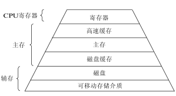

# 存储管理

- [存储管理](#存储管理)
  - [虚拟内存](#虚拟内存)
    - [分段](#分段)
    - [分页](#分页)
  - [硬件支持](#硬件支持)
    - [内存管理单元 MMU](#内存管理单元-mmu)
    - [旁路缓冲 TLB](#旁路缓冲-tlb)
    - [缺页中断](#缺页中断)
    - [存储层级 Storage Hierarchy](#存储层级-storage-hierarchy)
    - [交换空间](#交换空间)
  - [Linux中的虚拟内存](#linux中的虚拟内存)
  - [参考](#参考)

在进程的笔记中，我们提到了操作系统为进程提供了地址空间（Address Space）这个易用的物理内存抽象。通过这一机制，每个程序都会认为它将被加载到特定地址的内存中，并且具有非常大的空间。而地址空间背后的技术正是我们这次笔记的主要内容——虚拟内存。

## 虚拟内存

虚拟内存是计算机内存管理的一种技术。它使得每一个进程认为自己拥有连续可用的内存，同时将让进程彼此隔离从而防止相互造成伤害。实际上，这个进程所对应的实际物理内存由主存中多个不连续的内存碎片和暂时不使用而存放在磁盘中的部分组成。

总体而言，虚拟内存有三大目标：

- 透明性：程序不应该感知到内存被虚拟化的事实，相反，程序的行为就好像它拥有自己的私有物理内存。在幕后，操作系统（和硬件）完成了所有的工作，让不同的工作复用内存，从而实现这个假象。
- 高效率：操作系统总是追求虚拟化尽可能高效，包括时间上（即不会使程序运行得更慢）和空间上（即不需要太多额外的内存来支持虚拟化）。
- 隔离性：操作系统应确保进程受到保护，不会受其他进程影响，操作系统本身也不会受进程影响。

为了实现这些目标，虚拟内存提出了分段和分页两种机制，并将二者结合起来使用，最终达成了从虚拟地址到物理地址的映射。

### 分段

到目前为止，我们一直假设将所有进程的地址空间完整地加载到内存中，如图1所示。利用基址和界限寄存器，操作系统很容易将不同进程重定位到不同的物理内存区域。但是，栈和堆之间的大块空闲空间就会显得很浪费。

**泛化的的基址/界限**：

为了改善这一问题，计算机引入了分段（Segmentation）机制。通过在硬件中设置多对基址和界限寄存器，将地址空间中的不同逻辑段（如代码段、数据段、堆、栈）独立重定位到物理内存的不同区域，从而避免了虚拟地址空间中未使用的中间空白部分占用宝贵的物理内存。

**操作系统对分段的支持**：

为了支持分段机制，操作系统需要解决两个核心问题：

- 上下文切换时的寄存器保存与恢复：每次发生进程切换时，操作系统必须将当前进程的各段寄存器值保存到进程控制块（PCB）中，并在恢复进程时重新加载，以保证每个进程看到正确的地址映射。
- 空闲物理空间的管理：操作系统需要额外的数据结构（如空闲列表、位图等）来追踪和管理未被分配的物理内存区域，以支持高效的段分配与回收。

**外部碎片**：

尽管分段有效提高了内存利用率，但在频繁创建和销毁进程、反复分配空间之后，物理内存中会逐渐积累许多零散的小空闲区域。这些分散的"空洞"使得操作系统难以为新段分配足够的连续空间，也无法有效地扩大已有段。

这种问题被称为外部碎片（External Fragmentation）。常见的解决方案包括：

- 内存紧缩：操作系统先暂停运行的进程，将它们的数据复制到连续的内存区域中，然后更新段寄存器中的基址值，指向新的物理地址，从而腾出一大块连续的空闲空间。
- 高效的空闲列表管理与分配算法：通过优化内存分配策略（如首次适应 First-Fit、最佳适应 Best-Fit、最差适应 Worst-Fit 等），在分配之初就精细化管理空闲块，尽量减少碎片的产生。

跟多解决外部碎片以及内部碎片的方案，可以参考 [JVM 中的内存管理策略](../../language/java/jvm.md)。

### 分页

尽管分段机制有效避免了虚拟地址空间内部的空白浪费，但由于逻辑段长度不固定，物理内存最终依然会陷入外部碎片的困境。为了彻底解决这一问题，计算机引入了与数据库存储设计思想类似的分页（Paging）机制。

在分页机制下，虚拟内存空间和物理内存空间被严格切割为固定大小的底层单元：

- 虚拟内存被切分为大小相等的页（Page）。
- 物理内存被切分为大小相等的页帧（Page Frame，或称 Physical Frame）。
- 页与页帧的大小通常严格相等（比如，操作系统中页大小一般为 4 KB，数据库中则为 64 KB）。

**页表与地址转换**：

为了高效实现地址转换，系统将地址划分为页号与偏移量。以虚拟地址（Virtual Address，简称 $\text{VA}$）为例，它在数学上可以被拆解并写作：

$$\text{VA} = (\text{VPN} \ll k) + \text{Offset}$$

其中：

- 高位的虚拟页号（Virtual Page Number, 简称 $\text{VPN}$）：用于标识该地址位于第几个虚拟页。
- 低位的页内偏移量（Page Offset, 简称 $\text{Offset}$）：用于标识该地址在当前页内部的具体字节位置（占用 $k$ 位）。

类似的，物理地址（Physical Address，简称 PA）也可以写作：

$$\text{PA} = (\text{PPN} \ll k) + \text{Offset}$$

由于页内偏移量在地址翻译前后保持不变，因此虚拟地址到物理地址的转换，本质上就是将虚拟页号（$\text{VPN}$）翻译为物理页帧号（$\text{PPN}$）。而这个过程由页表（Page Table）以及硬件内存管理单元（Memory Management Unit）共同完成：MMU 负责在硬件层面提取 VPN 并执行查表操作，而页表则提供实际的映射数据。

具体而言，在分页机制中，系统会为每个进程分配一个用于存储页实际存储位置的页表。从数学角度来看，页表就是一个映射函数，其入参是虚拟页号（Virtual Page Number，简称 VPN），输出是对应的物理页帧号（Physical Page Number，简称 PPN）：

$$\text{PPN} = \text{PageTable}(\text{VPN})$$

**页表项**：

页表由多个页表项（Page Table Entry, 简称 PTE）组成。每一个 PTE 不仅记录了物理页帧号，还包含了一系列关键的硬件控制与状态标志位：

- 有效位（Valid Bit）：指示该页是否已加载到物理内存中。
- 保护位（Protection Bit）：表明该页是否允许读取、写入或执行。
- 脏位（Dirty Bit）：表明该页面被加载到内存后是否被修改过，用于页面置换时判断是否需要写回磁盘。
- 物理页帧号（Frame Number）：记录该虚拟页当前所在的物理页帧编号。

**多级页表**：

简单的线性页表往往会占用过多的内存。以 32 位地址空间、$4\,\text{KB}$ 页大小为例，单级页表需要 $2^{20}$ 个表项，仅页表本身就需要连续消耗 $4\,\text{MB}$ 的物理内存——这对于一个可能只使用了极小地址空间的进程来说代价过高；而在 64 位系统下，这种开销更会导致数十 GB 的空间膨胀。

为了解决单级线性页表带来的空间爆炸问题，计算机科学引入了多级页表（Multi-Level Page Table）。它的核心数学思想是“按需分配”与“树状折叠（Tree-based Indexing）”：将庞大的单级线性页表切分成与页大小相同的块。引入上一级的页目录（Page Directory）去追踪这些块。如果某一大块虚拟地址空间在进程中完全没有被使用，那么该块对应的整个上级目录项可以直接设为“无效（Null）”，从而直接省去这一整块下级页表的内存开销。

以常见的 4 级页表（如 x86-64 架构中的 PGD $\rightarrow$ PUD $\rightarrow$ PMD $\rightarrow$ PTE）为例，虚拟地址的 $\text{VPN}$ 被进一步切分为多段（例如每段 9 位，外加 12 位偏移量）：$$\text{VPN} = [\text{PGD Index}] + [\text{PUD Index}] + [\text{PMD Index}] + [\text{PTE Index}]$$

**页表与磁盘**：

尽管多级页表能够有效地减少页表占用内存，但对于需要支持同时运行多个进程的系统来说，物理内存仍是短缺的。因此，一些系统选择将页表放入内核虚拟内存（Kernel Virtual Memory），从而允许系统在内存压力较大时，将这些页表中的一部分暂时交换到磁盘。

**内部碎片**：

分页机制虽然彻底消灭了分段产生的外部碎片，但由于内存分配严格以固定大小的“页”为单位，如果进程实际申请的内存大小并不是页大小的整数倍，最后一页往往会产生无法被充分利用的空白空间，从而导致轻微的内部碎片（Internal Fragmentation）。

## 硬件支持

### 内存管理单元 MMU

内存管理单元（Memory Management Unit，MMU）是 CPU 芯片中负责管理内存的硬件子模块，也是分页机制中完成 VPN 到 PPN 映射的硬件基础。现代处理器通常为每个计算核心配备独立的 MMU，使其能够并行处理地址转换请求。

具体而言，MMU 根据页表基址寄存器定位当前进程的页表，提取虚拟地址中的 VPN 进行查表，最终输出对应的 PPN 并与偏移量拼接为物理地址。除了地址翻译，MMU 还承担内存访问权限检查（读/写/执行）以及异常报告等职责。

**CPU Core 架构**：

实际上，一个现代的 CPU Core 中通常包含：

- ALU / FPU（算术逻辑单元与浮点运算单元）：负责执行所有的数学计算（加减乘除、位运算、浮点数计算）。
- Register File（寄存器堆）：存放通用寄存器（如 RAX, RBX 等）和程序计数器（PC），是 CPU 内部速度最快、体积最小的存储阵列。
- Control Unit（控制单元 / 译码器）：负责把机器码指令“翻译”成底层控制信号，指挥 ALU、MMU 和寄存器协同工作。
- L1 Instruction Cache & L1 Data Cache（一级指令/数据缓存）：紧贴着执行流水线的高速缓存。正如前文所述，现代 CPU 普遍采用 VIPT 缓存设计，让 L1 缓存的查找与 MMU 的 TLB 查找并行发生。
- MMU（内存管理单元，含 TLB）：负责所有虚拟地址到物理地址的翻译、页表走查和内存权限检查。

**MMU 架构**：

可见，MMU 绝不仅仅是一个简单的静态查表工具，而是一个高度集成的纯硬件子系统。在其微观硅片架构上，主要包含以下几个核心硬件模块：

- 旁路缓冲（Translation Lookaside Buffer，TLB）：利用内容寻址存储器（CAM）和并行比对电路，在单个时钟周期内完成高速映射查找。
- 硬件页表走查器（Page Table Walker, PTW）：由纯硬件有限状态机（FSM）组成的逻辑电路。当发生 TLB 未命中时，PTW 会自动接管总线，像流水线一样直接从物理内存中抓取多级页表项，无需任何软件干预。
- 内存保护与权限检查逻辑：在翻译地址的同时，并行比对 CPU 特权级与页表项中的访问权限（R/W/X），保障进程间的安全隔离。

### 旁路缓冲 TLB

**加速地址翻译**：

使用分页机制实现虚拟内存会带来较高的性能开销，因为每次地址翻译都需要先访问内存中的页表，再访问实际数据，相当于逻辑上多了一次内存访问。

为此，工程师引入了地址转换旁路缓冲器（Translation Lookaside Buffer，TLB）来加速这一过程。TLB 是页表的一个小型硬件缓存，集成在 MMU 内部。 当系统需要进行地址翻译时，会首先查询 TLB；若命中，则无需再访问页表，从而大幅提升地址翻译速度。

**缓存局部性**：

缓存是计算机系统中最基本的性能改进技术之一。它背后的思想是利用指令和数据引用的局部性（Locality）。通常有两种局部性：

- 时间局部性（Temporal Locality）是指，最近访问过的指令或数据项可能很快会再次访问。比如：循环中的循环变量或指令，它们就会被多次反复访问。
- 空间局部性（Spatial Locality）是指，当程序访问某个地址的内存时，它可能很快会访问邻近该地址的内存。比如：遍历数组之类的情况。

**TLB未命中**：

当TLB未命中时，可能会由硬件或软件（操作系统）来处理。对于前者来说，硬件会“遍历”页表，找到正确的页表项，取出想要的转换映射，用它更新TLB，并重试该指令。而后者则是首先由硬件抛出一个异常，操作系统会重新获取CPU控制权（切换到内核模式）陷阱处理程序（Trap Handler）来更新TLB。

**TLB替换策略**：

和其他缓存类似，TLB也需要考虑缓存替换的策略。其常见的方法如下：

- LRU(Last Recently Used)
- NRU(Not Recently Used) 只看上一个指令周期的
- FIFO(First In First Out)

**上下文切换与TLB**：

由于TLB中存储的仅与当前进程相关的映射信息，因此最简单的方法就是清空TLB。不过这种方案在进程初始化时，会频繁的触发TLB未命中并带来大量的CPU开销，所以人们又提供了一种TLB共享的方案。通过添加地址空间标识符，来帮助TLB同时缓存不同进程的地址空间映射。

### 缺页中断

访问不在物理内存中的页，这种行为通常被称为页错误（Page Fault）。一般来说，这就意味着程序正在访问的虚拟地址空间的一部分，被操作系统交换到了硬盘上。此时，操作系统就会夺回CPU控制权，使用页错误处理程序将缺页置换到内存中，重新执行发生错位的指令。

### 存储层级 Storage Hierarchy

计算机将其内部的存储设备按价格高低和读取速度划分成几个层级，如图3所示。

在之前我们提到，由于页表过大，操作系统会将部分页表条目放在磁盘。在实际应用中，系统也会将没有使用的页存放在磁盘中，而非让其常驻在内存里。换句话说，主存就是磁盘的缓存，类似TLB和页表的关系。

> 补充：廉价磁盘冗余阵列（Redundant Array of Inexpensive Disks，RAID）指的是利用虚拟化存储技术把多个硬盘组成一个或多个硬盘阵列组的技术，它能使得磁盘整体可用性性提升。

### 交换空间

交换空间（Swap Space）是操作系统在硬盘上开辟的一块区域，用于物理页的换入和换出。当物理内存不足时，内核会将不活跃的内存页迁移到交换空间，释放物理内存供活跃进程使用；当这些页再次被访问时，再从交换空间换回内存。

以前文提到的页表也可以临时存放在交换空间为例，其运行过程如下：

- 内存告急与触发换出（Swap-out）：假设系统运行了太多程序，物理内存快被占满了。内核的内存回收守护进程（如 kswapd）开始扫描内存，发现某进程在堆上分配的一块内存已经很久没被访问了（属于“冷数据”）。内核决定将这一页（假设大小为 $4\,\text{KB}$）腾出来，将其写入硬盘预留的交换分区或交换文件（Swap File）中。
- 修改页表项与 Swap Entry（关键转换）：当这一页被写入磁盘后，它原本在物理内存中的“物理页帧号（PPN）”就失效了。此时，内核会修改该页对应的页表项（PTE）：有效位（Valid Bit） 被设为 0（表示不在物理内存中）。PTE 剩余的比特位不再记录 PPN，而是记录一个特殊的标志——交换项（Swap Entry）。这个 Swap Entry 内部编码了两样东西：哪一个交换文件/设备，以及在磁盘文件的第几个偏移量块上。
- 再次访问与缺页中断触发 Swap-in：过了很久，该进程突然又需要读取这块内存的数据了。CPU 执行到该地址时，MMU 去查页表，发现 Valid 位是 0。MMU 无法完成翻译，立即触发缺页中断（Page Fault），CPU 陷入内核态。内核的缺页异常处理程序接管 CPU，检查这个 PTE，发现里面存的不是普通的未加载标志，而是一个 Swap Entry。内核根据 Swap Entry 里的磁盘地址，指挥磁盘控制器把这 $4\,\text{KB}$ 的数据从硬盘重新读入到一个空闲的物理页帧中。
- 恢复正常映射：内核将新分配的物理页帧号（PPN）写回页表项，把有效位重新设为 1，并清除原先的 Swap Entry。操作系统恢复被中断的进程，进程毫无感知地继续执行。

## Linux中的虚拟内存

## 参考

- [深入理解计算机系统-第9章 虚拟内存](https://hansimov.gitbook.io/csapp/)
- [深入剖析虚拟内存工作原理](https://cloud.tencent.com/developer/article/1821336)
- [geeks - Differences between paging and segment](https://www.geeksforgeeks.org/difference-between-paging-and-segmentation/)
