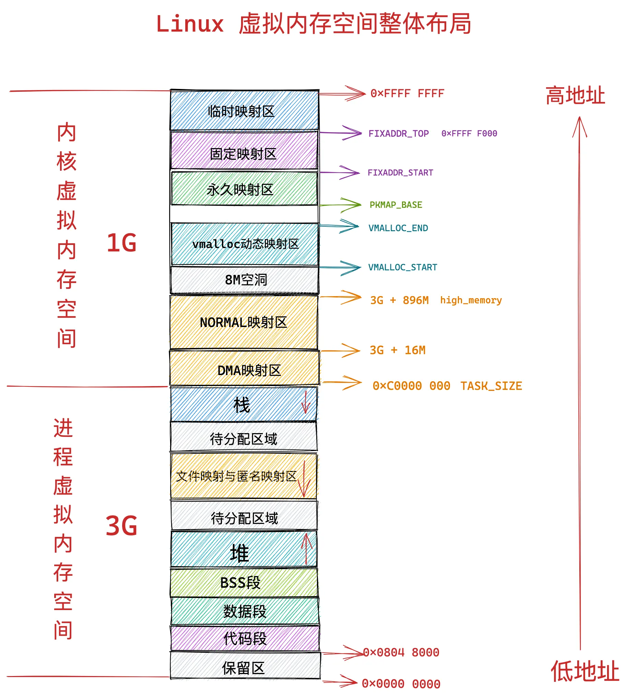
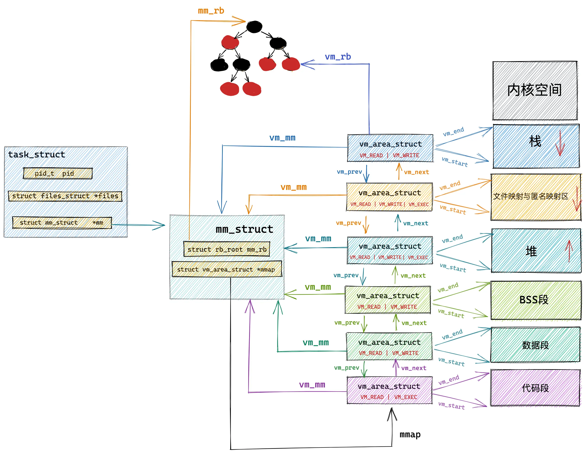

# Linux中的内存管理

- [Linux中的内存管理](#linux中的内存管理)
  - [进程地址空间](#进程地址空间)
    - [用户空间](#用户空间)
    - [内核空间](#内核空间)
  - [用户态内存管理](#用户态内存管理)
    - [关键字new](#关键字new)
    - [glibc中的malloc](#glibc中的malloc)
    - [系统调用brk与mmap](#系统调用brk与mmap)
    - [内存分配器ptmalloc](#内存分配器ptmalloc)
  - [内核态内存管理](#内核态内存管理)
    - [非一致性内存访问](#非一致性内存访问)
    - [伙伴系统](#伙伴系统)
    - [SLAB分配器](#slab分配器)
    - [高位地址映射](#高位地址映射)
  - [参考](#参考)

## 进程地址空间



### 用户空间

在 Linux 系统中，虚拟内存与进程紧密绑定，其核心目的在于为多进程系统提供隔离保障。由于进程和线程在内核中均通过 task_struct 结构体表示，每个 task_struct 内部都包含一个指向 mm_struct 结构体的指针，用于管理进程的虚拟地址空间。对于多线程场景，同一进程下的多个线程会共享同一个 mm_struct 结构体，从而实现了线程间对进程虚拟地址空间的共享。

**用户空间描述符**：

mm_struct 结构体是整个进程虚拟地址空间的顶层描述符，其核心定义与关键字段如下所示：

```c++
struct mm_struct {
  // 1. 进程地址空间的核心标识
  unsigned long start_code, end_code;    // text段：起始/结束虚拟地址
  unsigned long start_data, end_data;    // data段：起始/结束虚拟地址
  unsigned long start_brk, brk;          // 堆区：起始/当前堆顶虚拟地址
  unsigned long start_stack;             // 主线程栈：起始虚拟地址（高地址）
  unsigned long start_bss, end_bss;      // bss段：起始/结束虚拟地址（部分内核版本合并到data相关字段）
  
  // 2. 内存区域链表（最核心！记录所有内存段的详细映射）
  struct vm_area_struct *mmap;           // 指向所有内存区域的链表头
  struct rb_root mm_rb;                  // 内存区域的红黑树（加速查找）
  
  // 3. 页表相关（虚拟地址→物理地址的映射表）
  pgd_t *pgd;                            // 页全局目录（页表的顶级指针）
  
  // 4. 权限与大小限制
  unsigned long total_vm;                // 进程使用的总虚拟内存大小
  unsigned long locked_vm;               // 锁定的内存页（不被换出）
  unsigned long flags;                   // 内存标志（如MM_WRITEABLE、MM_EXECUTABLE）
  
  // 5. 共享与计数
  atomic_t mm_users;                     // 使用该mm_struct的线程数（多线程共享时计数）
  atomic_t mm_count;                     // 引用计数（销毁时判断）
  struct task_struct *owner;             // 所属进程（主线程）

  // ...
};
```

其中，start_xxx 和 end_xxx 字段分别表示该段内存的起始虚拟地址和结束虚拟地址，对应着前文介绍的分段机制段表。而紧随其后的 pgd（Page Global Directory，页全局目录）字段，则直接指向了硬件分页机制的顶层入口。它保存着当前进程顶级页表在物理内存中的基地址（最终会被加载到 CPU 的 CR3 寄存器中），是硬件 MMU 进行虚拟地址到物理地址多级查表转换的起点。

**虚拟内存区域**：

不过，mm_struct 的真正核心还是在于 mmap 链表和 mm_rb 红黑树组织起来的 vm_area_struct 对象。如下图所示，每一个 vm_area_struct 都对应着进程虚拟地址空间中的一个独立段落，记录了该段内存的起止边界、访问权限以及各类属性标志。



依据内部的 vm_file 指针是否为 NULL，vm_area_struct 对象可分为两大类：

- 文件映射（File-backed Mapping，vm_file $\neq$ NULL）：该内存区域与磁盘文件或设备直接关联（如代码段、动态库 .so 或显式 mmap 映射的文件）。触发缺页中断时，内核会通过 vm_file 和偏移量从 Page Cache 或磁盘中读取真实的文件数据。
- 匿名映射（Anonymous Mapping，vm_file = NULL）：该内存区域不对应任何磁盘文件（如堆区、栈区、BSS 段及匿名 mmap 内存）。触发缺页中断时，内核无需进行磁盘 I/O，只需向伙伴系统申请干净的物理页并将其全部清零（Zero-fill）即可。

```c++
struct vm_area_struct {
  // 1. 虚拟内存区域的起止边界
  unsigned long vm_start;     // 这段虚拟内存区域的起始地址（包含）
  unsigned long vm_end;       // 这段虚拟内存区域的结束地址（不包含）

  // 2. 组织结构与所属进程内存描述符指针
  struct vm_area_struct *vm_next, *vm_prev; // 双向链表节点，用于顺序遍历所有 VMA
  struct rb_node vm_rb;                     // 红黑树节点，用于加速虚拟地址查找
  struct mm_struct *vm_mm;                  // 指向所属进程的 mm_struct 内存描述符

  // 3. 访问权限与属性标志位
  pgprot_t vm_page_prot;      // 硬件页表会用到的访问权限（读/写/执行）
  unsigned long vm_flags;     // 各种属性标志（如 VM_READ, VM_WRITE, VM_SHARED）

  // 4. 文件映射相关字段（若是文件映射则生效）
  unsigned long vm_pgoff;     // 文件内的偏移量（以 Page 为单位）
  struct file *vm_file;       // 指向被映射的文件的 file 结构体（若为纯匿名内存则为 NULL）
  const struct vm_operations_struct *vm_ops; // 专属的操作函数指针（如缺页时的 readpage）

  // 5. 匿名内存管理与私有数据
  struct anon_vma *anon_vma;  // 关联的匿名内存管理结构（用于匿名映射/写时复制）
  void *vm_private_data;      // 驱动或子系统的私有数据指针
};
```

其中，vm_file 字段指向的 file 结构体，是 VFS 中提供的文件对象，内部包含 file_operations 函数指针表，提供了对该文件进行读、写、mmap 等操作的底层能力，具体见[文件系统](./persistence/file%20system.md)中的说明。也就是说，vm_file 决定了这段 VMA 映射的数据来源：当内核需要把文件内容加载到物理页时，最终会通过 vm_file 关联的 address_space 和 file_operations 完成数据读取。

**内存映射行为表**：

而 vm_operations_struct 并不是文件操作表，它是 VMA 自身的内存映射行为表。它描述的是这段虚拟内存区域在生命周期变化、缺页、写保护等场景下，内核应该如何处理。其核心操作包括：

- open：当该 VMA 被插入进程地址空间，例如通过 mmap 建立映射或通过 fork 复制地址空间时调用，用于完成 VMA 的初始化或引用计数管理。
- close：当该 VMA 从进程地址空间中移除或销毁时调用，用于释放与该映射相关的资源。
- fault：当进程访问某虚拟地址但对应物理页尚未建立映射时触发缺页异常，内核通过 fault 回调把缺失的页从 Page Cache、磁盘或设备中恢复进来。

```c++
struct vm_operations_struct {
  // 1. 生命周期管理
  void (*open)(struct vm_area_struct *area);
  void (*close)(struct vm_area_struct *area);

  // 2. 结构变更
  int (*split)(struct vm_area_struct *area, unsigned long addr);
  int (*mremap)(struct vm_area_struct *area, unsigned long old_address,
                unsigned long old_size, unsigned long new_address,
                unsigned long new_size);

  // 3. 缺页中断与页面加载（最核心）
  vm_fault_t (*fault)(struct vm_area_struct *vma, struct vm_fault *vmf);
  vm_fault_t (*huge_fault)(struct vm_area_struct *vma, struct vm_fault *vmf, enum page_entry_size size);
  void (*map_pages)(struct vm_area_struct *vma, struct vm_fault *vmf);

  // 4. 写保护与脏页处理
  vm_fault_t (*page_mkwrite)(struct vm_area_struct *vma, struct vm_fault *vmf);
  vm_fault_t (*pfn_mkwrite)(struct vm_area_struct *vma, struct vm_fault *vmf);

  // 5. 调试与访问
  int (*access)(struct vm_area_struct *vma, unsigned long addr,
                void *buf, int len, int write);
                
  // ... 其他扩展字段（如名字、策略等）
};
```

一般来说，vm_ops 字段的值并不是由内核凭空指定的，而是由该内存区域背后的实际控制者在初始化（即执行 file_operations->mmap）时动态赋予的。根据映射对象的不同，其提供者主要分为以下几类：

- 磁盘文件映射：由对应的文件系统（如 Ext4 / XFS）提供。当用户态对普通文件发起 mmap 时，文件系统的 mmap 函数会将专属的 vm_ops（如内核通用的文件内存操作集）绑定到 VMA 上，其内部的 fault 回调负责通过 vm_file 将文件内容从磁盘或 Page Cache 中加载到物理内存中。
- 硬件设备与显存映射：由对应的设备驱动（如 DRM 显卡驱动）定制提供。当用户态通过 mmap 映射显卡设备文件时，驱动的 file_operations->mmap 会充当“配置工厂”，为主键 VMA 挂载驱动专属的 vm_ops。这样，当程序访问显存触发缺页时，驱动就能直接接管并控制硬件或分配显存物理页。
- 纯匿名映射：由于 vm_file 为 NULL，该 VMA 通常不需要外部文件系统或驱动介入，其 vm_ops 往往为 NULL，一切生命周期与缺页逻辑完全由操作系统内核底层的通用内存管理机制托管。

### 内核空间

与用户空间每个进程都拥有一套独立 mm_struct 和私有虚拟地址空间不同，内核空间在宏观上是所有进程共享的。在传统的 32 位 Linux 系统中，高 1GB 的虚拟地址空间对于所有进程而言都是相同的。当进程陷入内核态时，CPU 切换执行内核代码，共用的也是同一套内核页表。

**内核空间分区**：

如图所示，内核虚拟内存空间从低到高主要划分为以下几个关键区域：

- **直接映射区（线性映射区）**：物理地址和虚拟地址之间存在固定偏移映射关系，无需复杂页表动态维护，依靠数学公式完成地址转换；该区域的物理页由伙伴系统管理，通过 `struct page` 描述页帧。
- **vmalloc 区**：用于分配不连续的物理页、连续的内核虚拟地址，使用 `vm_struct` 链表管理每一块分配区域；`vmalloc`、`vmap` 均在此区域分配。
- **固定映射区（Fixmap）**：一组编译期预先预留的固定虚拟地址槽位，运行时按需映射到指定物理页，用于一些特殊硬件、临时映射场景。
- **持久映射区（KMAP）**：主要在 32 位系统供高端内存（HighMem）使用，把高端物理页临时映射到内核虚拟地址，现已在 64 位系统中基本废弃。
- **内核镜像区**：存放内核代码段、数据段、BSS 段，内核启动时就完成映射。

**内核空间描述符**：

内核空间的管理直接复用了 mm_struct 结构体。作为系统初始化后的第一个 mm_struct 实例，它被称为 init_mm。在 init_mm 内部，其 VMA 链表及红黑树完全为空——这是因为内核空间的整体布局在系统启动时已完成静态规划且分割固定，无需像用户空间那样依赖 VMA 动态切分。它主要借用了页全局目录 pgd 字段来统筹整个内核空间的页表基地址。

唯有动态的 vmalloc 映射区需要进行独立追踪。内核为此设计了专用的 struct vm_struct 结构体，用来管理虚拟地址连续但物理内存不连续的内核内存区：

```c++
struct vm_struct {
  struct vm_struct *next;           // 链表指针，用于将所有 vm_struct 串联起来
  void             *addr;           // 分配的虚拟内存起始地址
  unsigned long     size;           // 虚拟内存的大小（包含隔离字节）
  unsigned long     flags;          // 内存标志（如 VM_ALLOC 等）
  struct page     **pages;          // 指向底层真实的物理页指针数组
  unsigned int      nr_pages;       // 物理页的数量
  phys_addr_t       phys_addr;      // 物理地址（仅在IO映射等少数场景下使用）
  const void       *caller;         // 调用者的返回地址（用于调试与统计）
};
```

**内核空间隔离**：

由于用户空间与内核空间处于不同的特权级和地址隔离域，内核不能直接对用户空间地址进行指针解引用来读写数据。为了确保内核空间的隔离性并防止非法内存访问，内核必须通过 copy_from_user 和 copy_to_user 等专用函数，在执行严格的地址检查与异常处理后，安全地实现用户态与内核态之间的数据搬运。

## 用户态内存管理

### 关键字new

在 C++ 中，new 关键字常用于动态分配内存。它实际是一种语法糖，以 new T(...) 为例，这个 new 表达式会先调用 operator new(sizeof(T)) 分配原始内存，再在这块内存上调用 T 的构造函数。

默认的全局 operator new 内部通常就是调用 malloc，分配失败时会触发 new_handler，如果仍然无法释放内存，就抛出 std::bad_alloc。 对应的 operator delete 默认内部则调用 free。

```c++
void* operator new(std::size_t size) {
  void* p = malloc(size); // 内部直接转交给了 glibc 的 malloc！
  if (!p) {
    // 如果分配失败，抛出 std::bad_alloc 异常
    throw std::bad_alloc(); 
  }
  return p;
}
```

除了以 new 以及 delete 为代表的语法糖关键字之外，C++ 其他的关键字主要分为以下几类：

| 类别 | 代表关键字 | 编译后的产物 |
| --- | --- | --- |
| 1. 纯编译期概念 | `class`、`struct`、`namespace`、`public`、`template`、`typename`、`using`、`enum`、`constexpr` | 不直接生成 CPU 指令，主要进入编译器的符号表、类型系统、内存布局规划中；模板只有被实例化时才会产生对应代码 |
| 2. 直接映射为汇编指令 | `return`、`if`、`else`、`while`、`for`、`break`、`continue`、`goto`、`switch`、`case` | 通常直接变成机器指令，如 `ret`、`cmp`、`je`、`jmp`、`call`、条件跳转等 |
| 3. 语法糖 / 依赖运行时库 | `new`、`delete`、`throw`、`dynamic_cast`、`typeid`、`co_await`、`co_yield`、`co_return` | 被编译器展开为对运行时库函数的调用，如 `operator new`、`operator delete`、`__cxa_throw`、`__dynamic_cast`、协程状态机相关函数 |

补充说明，这个全局的 operator new 函数来自 libstdc++（GCC 的 C++ 标准库实现）或 libc++（LLVM/Clang 的 C++ 标准库实现）。你可能会疑惑为什么没有采用 -l 编译指令指定对应需要连接的库，g++ 仍然可以正常编译。这是因为 g++ 是 C++ 的编译器驱动（compiler driver），它在链接阶段会自动把 C++ 标准库加入链接命令，等价于自动追加 -lstdc++（GCC/libstdc++）或 -lc++（Clang/libc++）。可以用 g++ -v 查看完整的编译和链接过程，链接阶段会看到 collect2 / ld 实际接收到的参数中包含 -lstdc++。相比之下，如果用 gcc 编译 C++ 代码，默认不会自动链接 C++ 标准库，需要手动加 -lstdc++，否则会出现 undefined reference to std::cout 等链接错误

### glibc中的malloc

glibc 全称是 GNU C Library，它是 GNU 项目专门为类 Unix 操作系统开发的标准 C 语言函数库。具体而言，GNU 项目由理查德·斯托曼于 1983 年发起，旨在构建一个完全自由、兼容 Unix 的完整操作系统。虽然其最初计划自主开发的微内核（GNU Hurd）因架构设计极其复杂而长期延误、未能成为主流，但在这一过程中，GNU 社区沉淀并开源了一整套统治现代计算机世界的成熟工具链与核心组件，包括：

- 编译与构建套件：GCC、Binutils（包含 ld 链接器、as 汇编器）、GDB（调试器）以及 GNU Make（自动化构建工具）。
- 命令行解释器与工具集：Bash（命令行解释器）与 Coreutils（包含 ls、cat、cp、grep、sed 等核心命令行工具）
- C 标准库：底层系统调用封装（如 sys_open、sys_read 等）与 纯用户态的高性能工具函数（如 memcpy、strcmp 等）。

其中，malloc 函数是 glibc 提供的动态内存分配函数。它会在用户态维护一个内存池，并根据传入大小参数，从内存池中分配连续的内存空间。当用户态内存池不足时，malloc 会根据申请内存的规模走不同的底层分支：

- 当申请内存小于 128 KB 时，优先通过调整堆顶指针的系统调用 brk() 来扩容的堆空间。
- 反之，则绕过堆区，直接通过 mmap()（带 MAP_ANONYMOUS 标志）向内核请求一块独立的匿名虚拟内存区域（VMA）。这种大内存释放时会直接通过 munmap() 归还给操作系统。

其中，使用 brk 堆区管理小内存是因为堆顶指针只能整体往上抬或往下压。假设程序先申请了 10MB 的内存，紧接着在其后面又申请了 1KB 的内存。现在，程序把那 10MB 的大内存释放了。请问堆顶指针能降下来吗？不能！ 因为那块 1KB 的小内存还活着，并且挡在堆顶的后方。堆顶指针无法跨越还活着的内存块回缩。

### 系统调用brk与mmap

brk 是内核提供用于直接修改堆区 VMA 的系统调用。它能够根据传入的目标地址值，直接修改进程内存描述符 mm_struct 中的 brk_end 字段，并动态调整或扩展对应堆区（Heap VMA）的边界属性。与之相关的 sbrk 则是 glibc 封装的库函数，它接收一个增量值而非绝对地址：正数表示堆向上增长，负数表示堆收缩，传入 0 则用于查询当前的 brk 位置。

相比之下，mmap 则能够在进程空间中创建新的 VMA。它既可以用于申请大块的匿名虚拟内存（配合 MAP_ANONYMOUS 供 malloc 大内存分配使用），也可以用于将磁盘文件直接映射到内存中，实现高效的文件 I/O。

值得注意的是，无论是 brk 还是 mmap，值得注意的是，无论是 brk 还是 mmap，它们向内核申请的本质上都只是虚拟内存，物理页并不会在调用时立即分配，而是采用按需调页（Lazy Allocation）策略。当程序首次访问这些虚拟地址时，会触发缺页异常（Page Fault），随后内核介入，通过伙伴系统分配物理页并建立页表映射。

- 对于文件映射或特定自定义 VMA，内核通常会通过其关联的 vm_operations_struct 中的 fault 回调函数来处理物理页的加载；
- 而常规的匿名堆内存则由内核专用的匿名缺页处理逻辑来完成。

### 内存分配器ptmalloc

ptmalloc 是 glibc 中的默认内存分配器，也即 malloc / free 的实际实现者。与它定位相似的高性能内存分配器还包括 Google 开源的 tcmalloc 和 Meta 开源的 jemalloc。

**内存池 arena**：

ptmalloc 将进程管理的大片内存划分为若干个 arena。每个 arena 独立管理着内存块、空闲队列以及锁。其中，进程启动时创建的第一个 arena 称为 main arena，其他的则称为 thread arena。

- 对于 main arena 而言，它管理着进程唯一的堆空间 brk 段，因此主要通过 brk/sbrk 扩容，但也可以对大内存使用 mmap。
- 相比之下，thread arena 则只能通过 mmap 申请内存。

线程并不永久独占某个 arena，当 arena 数量达到上限后，多个线程会通过arena recycling 机制共享同一个 arena 并竞争其锁。

**内存块 chunk**：

chunk 是 ptmalloc 管理内存的基本单位，它由头部元数据和用户数据区组成。其中，头部元数据记录 prev_size、size 和标志位，空闲时通过 fd/bk 等指针挂入空闲链表。

借助头部记录的尺寸和状态信息，ptmalloc 能够以 $O(1)$ 的复杂度快速寻找到物理相邻的前后 Chunk，从而实现高效的相邻块合并，有效抑制内存碎片。

**空闲链表 bin**:

空闲 chunk 按照尺寸归类，挂载到不同类型 bin 中：

- Fast Bin：单向链表，LIFO 复用策略，释放时不执行相邻合并；
- Unsorted Bin：free 之后的中转缓冲区，是合并、重新分类前的暂存位置；
- Small Bin：管理固定尺寸的小块内存，双向链表；
- Large Bin：按区间组织大块内存；
- Top Chunk：arena 顶部剩余的连续空闲区域，各个 bin 都无法满足分配时，从 Top Chunk 切分内存。

**线程本地缓存 tcache**:

tcache 是 glibc 2.26 引入的线程私有缓存，包含 64 条单向链表，每条链表最多缓存 7 个 chunk，覆盖 64 位系统上约 32 到 1032 字节的小对象。 小对象 free 时优先放回 tcache，下次同尺寸 malloc 时直接取出，全程无锁，无需进入 Arena。

**分配主流程**：

一次 malloc 的调用流程通常包括：

- 先看 tcache，命中则直接返回，完全无锁；
- 未命中则进入 Arena，依次查找 Fast Bin、Small Bin、Unsorted Bin、Large Bin；
- 仍然不够就从 Top Chunk 切分；
- Top Chunk 不足时，小内存通过 brk/sbrk 扩展堆，大内存通过 mmap 映射匿名内存；
- 超过 mmap 阈值（默认约 128KB）的请求会直接走 mmap，释放时通过 munmap 还给内核。

**ptmalloc 的优化**：

- tcache 线程本地缓存是 glibc 2.26 后最重要的加速机制。每个线程有自己的 tcache，小对象 free 时先放回 tcache，下次 malloc 同尺寸时直接取出，不需要加锁，也不需要进入 Arena。
- arena 分配区解决多线程竞争。主线程使用 Main Arena，子线程使用 Thread Arena，每个 arena 有独立锁，数量通常与 CPU 核数相关。这样多个线程可以并行分配，而不是全部串行争抢一把全局锁。
- bin 分级让不同大小的分配请求都能快速命中。Fast Bin 适合极小对象，Small Bin 适合固定小尺寸，Large Bin 处理较大块，Unsorted Bin 作为释放后的中转缓冲区，避免每次释放都立即做复杂分类。
- mmap 与 brk 分工也很关键。小于阈值的小内存通过 brk 扩展堆，释放后通常留在用户态池中复用；大于阈值的大内存通过 mmap 分配，释放时直接 munmap 还给内核。所以小内存 free 后 RSS 不一定下降，这是分配器缓存策略，不等于泄漏。
- 合并与收缩用于控制碎片。free 时相邻空闲 chunk 会合并，合并后若与 Top Chunk 相邻则并入 Top Chunk。只有当 Top Chunk 超过收缩阈值时，Main arena 才可能通过 sbrk 把堆顶归还给内核。

## 内核态内存管理

前面提到的无论是 new、malloc、brk 还是 mmap，其本质上都属于用户态虚拟地址空间的调整，也即对进程 mm_struct 中 VMA 对象的修改。然而，这些操作并未直接分配物理页。当程序真正访问这些虚拟地址引发缺页异常时，内核态内存管理机制便会正式登场，负责完成物理页的分配与底层映射。

相较于用户态的虚拟内存管理，内核态的内存管理更加贴近硬件，主要依托于 NUMA 架构抽象、伙伴系统（Buddy System） 以及 SLAB/SLUB 分配器。

### 非一致性内存访问

为解决多 CPU 系统中共享总线带来的性能瓶颈，现代 Linux 引入了非一致性内存访问（Non-Uniform Memory Access，NUMA）架构。其核心设计思想在于为每个 CPU 节点配备专属的本地内存，从而使得不同 CPU 访问不同物理内存区域的延迟产生差异：访问本地节点内存速度更快，而访问远程节点内存则相对较慢。

对于普通的单 CPU 电脑，现代 Linux 内核为了统一代码逻辑，也会将整块物理内存抽象为一个 NUMA 节点来统一管理。其顶层数据结构为 pg_data_t，定义如下：

```c++
typedef struct pglist_data {
  // 1. 本节点内的内存域数组，例如 ZONE_DMA、ZONE_NORMAL
  struct zone node_zones[MAX_NR_ZONES];

  // 2. 本节点实际存在的内存域数量
  int nr_zones;

  // 3. 非稀疏内存模型下，指向本节点所有物理页描述符数组
  struct page *node_mem_map;

  // 4. 本节点起始页帧号、实际可用的物理页数、覆盖的总页数，包含内存空洞
  unsigned long node_start_pfn;
  unsigned long node_present_pages;
  unsigned long node_spanned_pages;

  // ...
} pg_data_t;
```

其中，为了隔离老旧外设的硬件寻址限制（如 DMA）、降低多 CPU 并发申请内存时的锁竞争并有效抑制内存碎片，NUMA 节点一般会将其管理的物理内存划分为多个 zone，也即 node_zones 数组字段。每个 zone 都有自己的属性，例如内存类型、水位线、自旋锁等。其核心定义如下：

```c++
struct zone {
  // 1. 伙伴系统的核心资产：各阶空闲链表数组
  struct free_area free_area[MAX_ORDER];

  // 2. 内存水位线（Watermarks，用于触发 kswapd 后台内存回收）
  unsigned long watermark[NR_WMARK];

  // 3. 统计与并发控制
  atomic_long_t vm_stat[NR_VM_ZONE_STAT]; // 区域页面状态统计
  spinlock_t lock;                        // 保护伙伴系统分配与回收的自旋锁

  // 4. 空间界定与归属
  unsigned long zone_start_pfn;           // 该 zone 在全局中的起始页帧号 (PFN)
  unsigned long spanned_pages;            // 该 zone 跨越的总页数（包含可能的物理内存空洞）
  unsigned long managed_pages;            // 实际交由伙伴系统管理的有效物理页数
  struct pglist_data *zone_pgdat;         // 指向所属的父 NUMA 节点
  char *name;                             // 区域名称（如 "DMA", "Normal" 等）
};
```

简而言之，node_zones 表示该 NUMA 节点下的各个内存功能区（负责具体的分配策略、锁与伙伴系统管理），而 node_mem_map 则指向该节点下所有物理页的元数据描述符数组（struct page 数组）起始地址。二者协同构成了 NUMA 物理内存管理的核心基石。

### 伙伴系统

伙伴系统是 Linux 内核用于管理各个 zone 中物理页帧的核心算法。其核心特点在于，以 2 的幂次为单位分配、释放连续物理页，并且能够自动合并相邻的空闲页，用来解决外部碎片问题。

**空闲链表**：

每个 zone 内部依靠 `free_area` 数组维护不同阶的空闲块，这是伙伴系统最核心的数据结构。其定义如下：

```c++
struct free_area {
  struct list_head free_list[MIGRATE_TYPES];
  unsigned long nr_free;
};
```

其中，struct list_head 是 Linux 内核中通用的侵入式双向循环链表设计。它并不直接存储业务数据或指针，而是内嵌在物理页的元数据描述符 struct page 结构体中：

```c++
struct page {
  // 1. 页面标志位（如是否为脏页、是否锁定、是否为复合页等）
  unsigned long flags;

  /* 2. 联合体：根据页面的身份复用内存空间 */
  union {
    struct {
      // 指向所属的 struct address_space（如果是文件页缓存）
      struct address_space *mapping;
      pgoff_t index;          // 在文件中的偏移量
      unsigned long private;  // 私有数据（在伙伴系统中，领头羊 page 会在这里记录 order 阶数！）
    };
    
    // 【关键】当该页作为空闲块加入伙伴系统时，复用此处的联合体：
    struct {
      struct list_head lru;   // 嵌入式双向链表节点（用于挂入 free_area）
      /* ... 其它伙伴系统辅助字段 ... */
    };

    struct {
      // 如果是复合页（Compound Page，如巨页或多页组合），指向首页（Head Page）
      struct page *compound_head;
      unsigned int compound_order; // 记录阶数
    };
  };

  // 3. 引用计数与映射计数
  atomic_t _refcount;     // 引用计数（为 0 时表示该页彻底空闲）
  atomic_t _mapcount;     // 被用户态页表映射的次数
};
```

具体而言，这个链表节点可由 struct page 中的内嵌成员变量 lru 提供。当物理页处于空闲状态并加入伙伴系统时，内核通过 list_entry，根据该 lru 节点的内存地址减去其在 struct page 结构体中的偏移量，瞬间反向推算出所属的 struct page * 完整首地址，从而实现了从链表节点到物理页元数据的精准映射。

**分配与回收**：

`zone->free_area[]` 数组下标对应 order 阶：`free_area[order]` 存放大小为 \(2^{order}\) 个连续页的空闲块。

- 分配：申请 \(2^k\) 页时，优先检查 `free_area[k]`。如果当前阶没有空闲块，向上查找更高阶；找到后对高阶块进行 split 对半切分，一半交付分配，另一半作为伙伴块放入低阶空闲链表。
- 释放：释放一块 \(2^k\) 页的块时，通过地址对齐公式算出它的伙伴块地址。如果伙伴同样空闲，则二者合并，晋升为 \(2^{k+1}\) 阶的块，继续向上检查、递归合并。

这种即时合并机制，保证系统尽可能保留大块连续物理内存，抑制外部碎片。

### SLAB分配器

SLAB 分配器是 Linux 内核在伙伴系统之上建立的一层对象级缓存分配器。其核心目的在于，通过预分配与缓存复用包括`task_struct`、`inode`、`dentry`、`struct page`等内核小对象，来避免频繁向伙伴系统申请内存的开销，并最大程度地减少内外部碎片。

**分配槽**：

在 SLAB 体系中，每个特定类型的对象池都由一个 kmem_cache 结构体统筹管理。它内部维护了三个核心的 slab 链表，分别用于追踪全满、部分空闲和全空的内存块：

```c++
struct kmem_cache {
  struct slab *slabs_full;      // 对象全部被占用的slab链表
  struct slab *slabs_partial;   // 部分对象空闲的slab链表
  struct slab *slabs_free;      // 所有对象都空闲的slab链表

  unsigned int object_size;     // 单个对象大小
  unsigned int size;            // 包含对齐、元数据后的实际槽大小
  unsigned int num;             // 一个slab里面可以存放多少个object

  void (*ctor)(void *obj);      // 对象构造回调（初始化）
  // ... 缓存名称、节点、迁移类型、CPU本地缓存等字段
};

struct slab {
  struct list_head list;
  unsigned long free;           // 下一个空闲对象索引
  void *s_mem;                  // slab内对象数组起始地址
  unsigned int inuse;           // 当前已分配对象数量
  // ...
};
```

**通用小内存对象分配kmalloc**：

除了针对特定内核数据结构的高速缓存外，SLAB 体系还衍生出了通用的 kmalloc 机制。内核在初始化时会预先建立一系列标准尺码的通用缓存池（如 kmalloc-32、kmalloc-64、kmalloc-128 等）。

当代码调用 kmalloc() 申请任意大小的内存时，内核会向上对齐并匹配最合适的标准槽位，直接从对应的 slab 缓存池中切出一个现成的槽位返回，从而实现了极高效的通用小内存动态分配。

一般来说，kmalloc() 所申请到的内存无论是物理地址还是虚拟地址均为连续的。且考虑到小内存的高频快速访问需求，它通常位于直接映射区（Lowmem），从而避免了多级页表转换的额外开销。

### 高位地址映射

在 32 位 Linux 系统架构中，内核的虚拟地址空间总共只有 1GB。其中，前 896MB 被划分为直接映射区（Lowmem），与物理内存的低端 896MB 呈线性一一对应。

然而，当系统的物理内存超过 896MB 时，剩下的物理内存无法被直接且永久地映射到内核的地址空间中。这部分超出直接映射范围的物理内存被称为高端内存（Highmem）。

为了让内核能够访问高端内存中的数据，内核必须采用动态的临时或永久映射机制。根据上下文场景的不同，主要分为以下两种核心映射方式：

- **永久映射 kmmap**：
- **临时映射 kmap_atomic**：

## 参考

- [4.6 深入理解 Linux 虚拟内存管理](https://www.xiaolincoding.com/os/3_memory/linux_mem.html)
- [4.7 深入理解 Linux 物理内存管理](https://www.xiaolincoding.com/os/3_memory/linux_mem2.html)
