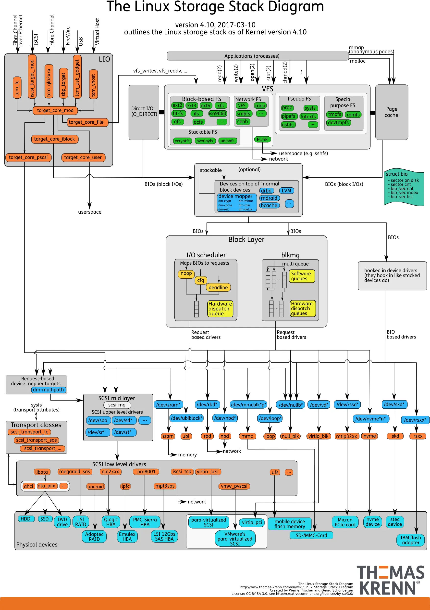

# 文件 & 文件系统

- [文件 \& 文件系统](#文件--文件系统)
  - [文件](#文件)
    - [文件类型](#文件类型)
    - [文件描述符](#文件描述符)
  - [虚拟文件系统](#虚拟文件系统)
    - [超级块](#超级块)
    - [索引节点](#索引节点)
    - [目录项](#目录项)
    - [文件对象](#文件对象)
    - [挂载](#挂载)
  - [块设备管理](#块设备管理)
    - [磁盘空间分配](#磁盘空间分配)
    - [目录组织](#目录组织)
    - [空闲空间管理](#空闲空间管理)
  - [参考](#参考)

## 文件

按Unix系统的设计理念，`Everything is file!`，即：操作系统中所有资源都可以当作文件看待。比如：

- 在`/proc`目录下看到系统当前运行的进程；
- 通过系统提供的套接字（Socket）或管道（Pipe）机制，使用类似读写文件的操作向另一条机器上运行的进程进行通信。

但是，文件最重要、最基本的作用还是作为块设备（持久化设备）的抽象，帮助计算机进行数据读取和写入。

### 文件类型

**文本文件/二进制文件**：

在计算机中，所有文件在硬盘上最终都是以二进制（0/1）形式存储。不过根据其在应用层面的读写差异，可将其分为：

- 文本文件：以「字符」为基本单位，存储的是「字符对应的编码值二进制数据」。因而必须通过指定的编码规则（如 UTF-8、GBK），才能将二进制数据映射为人类可读的字符。这意味着文本文件的读写强依赖编码一致性：若存储时采用 UTF-8 编码，读取时却误用 GBK 解析，就会出现乱码。
- 二进制文件：直接存储数据的原始二进制值，不依赖字符编码规则，而是遵循特定的文件格式规范（如 JPG 的图像数据结构、EXE 的可执行程序结构）。常见的二进制文件格式包括 .jpg、.exe、.mp4、.zip、.docx 等。这类文件若直接用 VS Code 等文本编辑器打开，会因编辑器强制按字符编码解析原始二进制数据，而呈现出乱码。

**普通文件/目录文件/特殊文件**：

而在文件系统的标准中，文件则可根据其本质与内核职责划分成了以下几种独立类型（可通过 ls -l 的首字符识别）：

- `-` 常规文件 (Regular File)：存储用户数据、程序代码、文本或二进制流的普通文件。
- `d` 目录文件 (Directory)：一种特殊的管理文件，其磁盘块不存放业务数据，而是专门存储目录项（Directory Entry）——即一组 (文件名, Inode号) 的键值对，以此建立文件名与对应元数据的映射关系。
- `l` 符号链接 / 软链接 (Symbolic Link)：包含目标文件路径字符串的特殊跳转文件，类似于快捷方式。
- `b` 块设备文件 (Block Device)：以固定大小的块为单位进行随机读写的硬件驱动抽象（如 /dev/sda 硬盘）。
- `c` 字符设备文件 (Character Device)：以无结构的字节流为单位进行连续读写的硬件抽象（如 /dev/tty 终端、键盘）。
- `p` 管道文件 / FIFO (Pipe)：用于具有亲缘关系或同机进程间通信的内核内存缓冲区。
- `s` 套接字文件 (Socket)：用于网络或本地跨进程间双向通信的端点。

**符号链接**：

符号链接是一种特殊的文件，它拥有自己独立的 Inode 和数据块，但其数据内容仅存储了指向目标文件的路径字符串。对用户而言，它类似于操作系统中的“快捷方式”：

- 路径简化与重定向：将深层目录或复杂的路径映射为便捷的短路径。
- 跨分区访问：由于存储的是纯路径文本，它完全支持跨文件系统或跨磁盘分区。
- 解耦性：创建时甚至不需要目标文件真实存在（允许存在“死链接”）。

与软链接不同，硬链接并不是一个独立的文件，它绕过了路径解析，直接在目录项中增加了一个“(文件名, 相同的 Inode 号)”的强绑定关系。

### 文件描述符

文件描述符（File Descriptor）是内核为每个进程维护的一个非负整数索引，用于标识进程打开的文件。对用户态程序而言，这个整数就是后续一切文件操作（如读、写、关闭）的唯一句柄。

通过这一机制，操作系统将复杂的底层文件系统与用户态程序彻底解耦，实现了统一且透明的文件访问。同时，所有文件访问请求都必须经过内核严格的权限校验与 fd 有效性检查后方可执行，从而在内核层构建起安全屏障，有效防止越权操作或破坏底层数据。

**进程/线程中的文件**：

在 Linux 中，进程与线程均使用 task_struct 结构体来表示。它根据 pid 与 tgid 字段来区分进程与线程。

- 主线程 / 独立进程：当 pid == tgid 时，代表它是线程组的领头羊（Thread Group Leader）。如果属于单线程程序，它就是传统意义上的独立进程；若在多线程中，则为主线程。
- 子线程：当 pid != tgid 时，代表它是一个通过 clone() 创建的子线程。它拥有自己独特的 pid（在用户态表现为 TID），但其 tgid 指向主线程的 pid，从而被内核归入同一个进程家族。

```c++
struct task_struct {
  // 1. 进程/线程标识
  pid_t pid;
  pid_t tgid;

  // 2. 进程/线程状态
  volatile long state;         // 运行态/睡眠态/僵尸态等

  // 3. 内存管理（关联 mm_struct）
  struct mm_struct *mm;        // 线程地址空间管理结构
  struct mm_struct *active_mm;

  // 4. 上下文信息（寄存器/栈）
  struct thread_struct thread; // 存储 CPU 寄存器、栈指针等

  // 5. 文件描述符表
  struct files_struct *files;  // 打开的文件描述符表

  // ... 还有上百个字段，此处简化
};
```

其中，task_struct 中的 files 字段指向一个 files_struct 结构体，它是进程管理打开文件的控制中心：

```c++
struct files_struct {
  /* 引用计数：记录当前有多少个 task_struct（线程）正在共享这套文件表 */
  atomic_t count;
  
  /* RCU 保护的文件描述符表指针（指向底层的 fdtable） */
  struct fdtable __rcu *fdt;
  
  /* 内嵌的默认文件描述符表（用于避免小进程频繁动态分配内存） */
  struct fdtable fdtab;
  
  /* 文件描述符分配时的优化位图（如下一个可用的 fd 下标） */
  int next_fd;
  unsigned long close_on_exec_init[1];
  unsigned long open_fds_init[1];
  unsigned long full_fds_bits_init[1];
  struct file __rcu * fd_array[NR_OPEN_DEFAULT];
};
```

而 files_struct 内部的 fdt 指针则指向真正存储文件指针的 struct fdtable：

```c++
struct fdtable {
  unsigned int max_fds;           /* 当前文件描述符表的最大容量（支持多少个 fd） */
  struct file __rcu **fd;         /* 指向真正的文件指针数组（即 fd -> struct file* 的映射） */
  unsigned long *close_on_exec;   /* 位图：记录哪些 fd 在 execve 时需要关闭 */
  unsigned long *open_fds;        /* 位图：记录哪些 fd 当前处于“已打开”状态 */
  unsigned long *full_fds_bits;   /* 辅助位图：用于加速查找下一个未使用的 fd */
  struct rcu_head rcu;            /* RCU 锁释放回调结构，用于无锁并发安全释放旧表 */
};
```

**文件描述符的访问与读写**：

基于上述结构体，进程便可实现根据文件描述符访问文件的操作。以 read(fd, buf, size) 为例，内核调用流程如下：

- 定位上下文：通过当前 CPU 的 current 指针找到当前任务的 task_struct，进而访问其 files 指针。
- 数组直接索引：以传入的整型 fd 作为数组下标，直接去 fdtable 的指针数组中捞出对应的 struct file * 指针（即 fdt->fd[fd]）。
- 安全检查与计数：进行边界检查（确认 fd 有效且未超限），并原子性地将该 struct file 的引用计数加 1，防止在读写过程中被其他线程意外关闭。
- 下发操作：顺着 struct file 找到其绑定的文件操作函数集（f_op->read），最终调用具体文件系统（如 Ext4）或设备驱动的底层读写逻辑完成数据传输。

**文件描述符的分配与管理**：

文件描述符是每个进程独自隔离的，换句话说，不同进程中相同的整型 fd 彼此完全独立，可以指向完全不同的文件或同一文件的独立访问实例。其分配与管理主要由 files_struct 及其底层的 fdtable 结构协同实现，具体流程如下：

- 位图与数组寻址：当进程调用 open() 创建或打开文件时，内核会在 fdtable 的 open_fds 位图中高效扫描，寻找第一个未被占用的比特位，将其对应的整数下标作为 fd（如 3）返回给用户态。
- 指针关联：内核在内存中创建对应的 struct file 实例（包含文件的元数据、当前读写偏移量 f_pos 及操作函数指针），并将其内存地址填入文件描述符指针数组对应的槽位中（即 fdt->fd[fd] = file_ptr）。
- 多线程共享：由于同一进程内的所有线程共享同一个 files_struct 和 fdtable，因此一个线程打开的文件，其他线程可以直接通过相同的整型 fd 进行读写，天然实现了线程间的文件资源共享。

**默认文件流**：

在系统启动或程序加载时，终端（Shell）通常会预先为进程打开三个标准流：

- fd = 0：标准输入（stdin）
- fd = 1：标准输出（stdout）
- fd = 2：标准错误（stderr）

当 Shell 调用 fork() 和 execve() 创建并执行新程序时，子进程会继承父进程的 files_struct（或者在 exec 过程中保持这三个文件描述符不变），因此程序一经启动，便能直接向 fd = 1 输出字符。

## 虚拟文件系统

虚拟文件系统（Virtual File System）是 Linux 内核中的一个软件抽象层，它为用户态程序提供了一套标准、统一的文件操作接口。

其核心作用是屏蔽底层不同文件系统（如 Ext4、XFS、NTFS 等）和物理设备的差异，让上层应用无需关心数据究竟存放在哪种文件系统或硬件上，就能以完全相同的方式进行透明访问。



### 超级块

超级块（Superblock）是整个文件系统的全局控制中心。当一个具体的文件系统（如 Ext4、XFS）被挂载到 Linux 目录树上时，内核会在内存中为其创建一个对应的 super_block 结构体，用来描述该文件系统实例的宏观状态。

### 索引节点

文件系统最重要的磁盘结构之一是Inode（Index Node），几乎所有的文件系统都有类似的结构。它用于描述保存给定文件的所有信息，包括：文件类型（例如，常规文件、目录等）、大小、分配给它的块数、保护信息（如谁拥有该文件以及谁可以访问它）、一些时间信息（包括文件创建、修改或上次访问的时间文件下），以及有关其数据块驻留在磁盘上的位置的信息（如某种类型的指针）。我们也称这些信息为元数据（Meta Data）。实际上，文件系统中除了纯粹的用户数据外，其他任何信息通常都称为元数据。

设计Inode时，最重要的决定之一是它如何引用数据块的位置。一种简单的方法是在Inode中有一个或多个直接指针（磁盘地址）。每个指针指向属于该文件的一个磁盘块。但这种方法难以支持寻址一个非常大的文件（例如，大于块的大小乘以直接指针数）。

**Inode号与软硬链接**：

每个Inode都有一个号码，操作系统用Inode号码来识别不同的文件。值得一提的是，Unix/Linux系统内部不使用文件名，而使用Inode号码来识别文件。对于系统来说，文件名只是Inode号码便于识别的别称或者绰号。

一般情况下，文件名和Inode号码是一一对应关系，每个Inode号码对应一个文件名。但是，Unix/Linux系统允许使用硬链接为文件创建别名。换句话说，硬链接本质上就是将多个文件名指向同一个Inode号码。而对于软链接，文件A和文件B的Inode号码虽然不一样，但是文件A的内容是文件B的路径。读取文件A时，系统会自动将访问者导向文件B。因此，无论打开哪一个文件，最终读取的都是文件B。

### 目录项

### 文件对象

```c++
struct file {
  const struct file_operations *f_op; // 指向具体文件系统或驱动实现的函数指针表（多态根源）
  loff_t                       f_pos; // 当前读写指针偏移量（Offset）
  fmode_t                      f_mode; // 文件访问模式（读、写等）
  unsigned int                 f_flags; // 打开时的标志（如阻塞、追加等）
  struct path                  f_path; // 对应的路径与 dentry 结构
  void                        *private_data; // 驱动或子系统的私有数据指针
  atomic_long_t                f_count; // 引用计数
};
```

### 挂载

**创建文件系统**：

为了在外接存储设备上创建一个文件系统，大多数文件系统提供了一个工具，通常名为mkfs。向mkfs提供一个设备（例如磁盘分区，例如/dev/sda1），一种文件系统类型（例如 ext3），它就在该磁盘分区上写入一个空文件系统，从根目录开始。

一旦创建了这样的文件系统之后，我们就可以通过挂载来访问磁盘上的数据。

**挂载的定义**：

挂载是指在原有的文件系统中创建一个挂载点（即目录）作为访问新文件系统的入口。因此，挂载的过程其实就是让内核建立磁盘分区的文件系统和某个目录之间的映射关系。之后对该目录的访问，实际上就是对磁盘分区数据的访问。

**需要挂载的原因**：

尽管外接磁盘在/dev目录下已经有了对应的设备文件节点(如/dev/sdb1)，但这仅表示内核已经检测到了这个磁盘设备的存在能够与之通信，但它无法直接访问设备文件。只有将磁盘分区上的文件系统挂载到某个目录之后，用户才能通过该目录访问磁盘文件系统进而访问磁盘上的数据。

## 块设备管理

### 磁盘空间分配

**磁盘分区**:

磁盘分区是使用分区编辑器（Partition editor）在磁盘上划分几个逻辑部分，盘片一旦划分成数个分区（Partition），不同类的目录与文件可以存储进不同的分区。换句话说，不同的分区中都包含一个独立的文件系统。

通过分区，我们可以将磁盘划分为多个独立的逻辑区域，每个区域都可以单独格式化成不同的文件系统(如ext4、xfs、ntfs等)。这为我们灵活组织数据、安装多个操作系统提供了基础。此外，独立分区可以使每个文件系统从属于不同的挂载点，从而实现分区挂载。这不仅便于磁盘空间管理，还可以增强文件系统的安全性和可用性。

**分区空间分配**：

每个分区都有自己的:

- 超级块(超级块记录文件系统元数据)
- Inode位图/数据块位图(标记空闲/已用)
- Inode表(存储所有文件的Inode元数据)
- 数据块区域(存储文件实际内容)

### 目录组织

一个目录基本上只包含一个二元组（子目录/文件名称，Inode号）的列表。

### 空闲空间管理

文件系统必须记录哪些Inode和数据块是空闲的，哪些不是，这样在分配新文件或目录时，就可以为它找到空间。因此，空闲空间管理（free space management）对于所有文件系统都很重要。常见的用于空闲空间管理的结构包括：位图和空闲链表等。

## 参考

- [Operating Systems: Three Easy Pieces: Files and Directories](https://pages.cs.wisc.edu/~remzi/OSTEP/Chinese/39.pdf)
- [Operating Systems: Three Easy Pieces: File System Implementation](https://pages.cs.wisc.edu/~remzi/OSTEP/Chinese/40.pdf)
