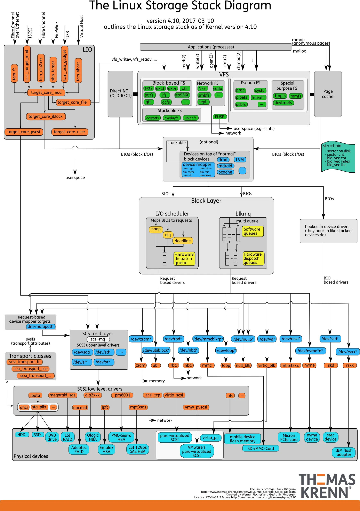

# 文件系统

- [文件系统](#文件系统)
  - [文件](#文件)
    - [文件类型](#文件类型)
    - [文件描述符](#文件描述符)
  - [虚拟文件系统](#虚拟文件系统)
    - [统一文件模型](#统一文件模型)
    - [挂载](#挂载)
    - [页缓存](#页缓存)
  - [通用块设备层](#通用块设备层)
    - [块设备描述符](#块设备描述符)
    - [块传输单元](#块传输单元)
  - [参考](#参考)

## 文件

按Unix系统的设计理念，`Everything is file!`，即：操作系统中所有资源都可以当作文件看待。比如：

- 在`/proc`目录下看到系统当前运行的进程；
- 通过系统提供的套接字（Socket）或管道（Pipe）机制，使用类似读写文件的操作向另一条机器上运行的进程进行通信。

但是，文件最重要、最基本的作用还是作为块设备（持久化设备）的抽象，帮助计算机进行数据读取和写入。

### 文件类型

**文本文件/二进制文件**：

在计算机中，所有文件在硬盘上最终都是以二进制（0/1）形式存储。不过根据其在应用层面的读写差异，可将其分为：

- 文本文件：以「字符」为基本单位，存储的是「字符对应的编码值二进制数据」。因而必须通过指定的编码规则（如 UTF-8、GBK），才能将二进制数据映射为人类可读的字符。这意味着文本文件的读写强依赖编码一致性：若存储时采用 UTF-8 编码，读取时却误用 GBK 解析，就会出现乱码。
- 二进制文件：直接存储数据的原始二进制值，不依赖字符编码规则，而是遵循特定的文件格式规范（如 JPG 的图像数据结构、EXE 的可执行程序结构）。常见的二进制文件格式包括 .jpg、.exe、.mp4、.zip、.docx 等。这类文件若直接用 VS Code 等文本编辑器打开，会因编辑器强制按字符编码解析原始二进制数据，而呈现出乱码。

**普通文件/目录文件/特殊文件**：

而在文件系统的标准中，文件则可根据其本质与内核职责划分成了以下几种独立类型（可通过 ls -l 的首字符识别）：

- `-` 常规文件 (Regular File)：存储用户数据、程序代码、文本或二进制流的普通文件。
- `d` 目录文件 (Directory)：一种特殊的管理文件，其磁盘块不存放业务数据，而是专门存储目录项（Directory Entry）——即一组 (文件名, Inode号) 的键值对，以此建立文件名与对应元数据的映射关系。
- `l` 符号链接 / 软链接 (Symbolic Link)：包含目标文件路径字符串的特殊跳转文件，类似于快捷方式。
- `b` 块设备文件 (Block Device)：以固定大小的块为单位进行随机读写的硬件驱动抽象（如 /dev/sda 硬盘）。
- `c` 字符设备文件 (Character Device)：以无结构的字节流为单位进行连续读写的硬件抽象（如 /dev/tty 终端、键盘）。
- `p` 管道文件 / FIFO (Pipe)：用于具有亲缘关系或同机进程间通信的内核内存缓冲区。
- `s` 套接字文件 (Socket)：用于网络或本地跨进程间双向通信的端点。

**符号链接**：

符号链接是一种特殊的文件，它拥有自己独立的 Inode 和数据块，但其数据内容仅存储了指向目标文件的路径字符串。对用户而言，它类似于操作系统中的“快捷方式”：

- 路径简化与重定向：将深层目录或复杂的路径映射为便捷的短路径。
- 跨分区访问：由于存储的是纯路径文本，它完全支持跨文件系统或跨磁盘分区。
- 解耦性：创建时甚至不需要目标文件真实存在（允许存在“死链接”）。

与软链接不同，硬链接并不是一个独立的文件，它绕过了路径解析，直接在目录项中增加了一个“(文件名, 相同的 Inode 号)”的强绑定关系。

**伪文件**：

除了上述常见的文件类型外，Linux 内核还定义了一类特殊的伪文件（Pseudo Files）。它们在磁盘上并不占用实际的存储空间，也不对应真实的物理块。其内容通常由内核在访问时动态生成，或者对应内核中的某种对象与缓冲区。常见的伪文件系统包括：

- `/proc`：提供进程信息、内核参数、系统状态等动态数据。
- `/sys`：提供内核对象、设备驱动、硬件信息等接口

伪文件是内核在内存中动态构建的“视窗”。当用户态程序对其进行 read() 或 write() 时，VFS 并不会去读写底层的磁盘块，而是直接触发内核中注册好的特定回调函数（file_operations）。这些函数在运行时实时收集内核内部的统计数据或状态，将其转换为文本流返回给用户。

伪文件完美体现了 Linux “一切皆文件”的设计哲学。它让开发者无需编写复杂的专有系统调用，就能直接通过标准的文件操作接口（open/read/write）实现对内核运行时的监控与交互。

### 文件描述符

文件描述符（File Descriptor）是内核为每个进程维护的一个非负整数索引，用于标识进程打开的文件。对用户态程序而言，这个整数就是后续一切文件操作（如读、写、关闭）的唯一句柄。

通过这一机制，操作系统将复杂的底层文件系统与用户态程序彻底解耦，实现了统一且透明的文件访问。同时，所有文件访问请求都必须经过内核严格的权限校验与 fd 有效性检查后方可执行，从而在内核层构建起安全屏障，有效防止越权操作或破坏底层数据。

**进程/线程中的文件**：

在 Linux 中，进程与线程均使用 task_struct 结构体来表示。它根据 pid 与 tgid 字段来区分进程与线程。

- 主线程 / 独立进程：当 pid == tgid 时，代表它是线程组的领头羊（Thread Group Leader）。如果属于单线程程序，它就是传统意义上的独立进程；若在多线程中，则为主线程。
- 子线程：当 pid != tgid 时，代表它是一个通过 clone() 创建的子线程。它拥有自己独特的 pid（在用户态表现为 TID），但其 tgid 指向主线程的 pid，从而被内核归入同一个进程家族。

```c++
struct task_struct {
  // 1. 进程/线程标识
  pid_t pid;
  pid_t tgid;

  // 2. 进程/线程状态
  volatile long state;         // 运行态/睡眠态/僵尸态等

  // 3. 内存管理（关联 mm_struct）
  struct mm_struct *mm;        // 线程地址空间管理结构
  struct mm_struct *active_mm;

  // 4. 上下文信息（寄存器/栈）
  struct thread_struct thread; // 存储 CPU 寄存器、栈指针等

  // 5. 文件描述符表
  struct files_struct *files;  // 打开的文件描述符表

  // ... 还有上百个字段，此处简化
};
```

其中，task_struct 中的 files 字段指向一个 files_struct 结构体，它是进程管理打开文件的控制中心：

```c++
struct files_struct {
  /* 引用计数：记录当前有多少个 task_struct（线程）正在共享这套文件表 */
  atomic_t count;
  
  /* RCU 保护的文件描述符表指针（指向底层的 fdtable） */
  struct fdtable __rcu *fdt;
  
  /* 内嵌的默认文件描述符表（用于避免小进程频繁动态分配内存） */
  struct fdtable fdtab;
  
  /* 文件描述符分配时的优化位图（如下一个可用的 fd 下标） */
  int next_fd;
  unsigned long close_on_exec_init[1];
  unsigned long open_fds_init[1];
  unsigned long full_fds_bits_init[1];
  struct file __rcu * fd_array[NR_OPEN_DEFAULT];
};
```

而 files_struct 内部的 fdt 指针则指向真正存储文件指针的 struct fdtable：

```c++
struct fdtable {
  unsigned int max_fds;           /* 当前文件描述符表的最大容量（支持多少个 fd） */
  struct file __rcu **fd;         /* 指向真正的文件指针数组（即 fd -> struct file* 的映射） */
  unsigned long *close_on_exec;   /* 位图：记录哪些 fd 在 execve 时需要关闭 */
  unsigned long *open_fds;        /* 位图：记录哪些 fd 当前处于“已打开”状态 */
  unsigned long *full_fds_bits;   /* 辅助位图：用于加速查找下一个未使用的 fd */
  struct rcu_head rcu;            /* RCU 锁释放回调结构，用于无锁并发安全释放旧表 */
};
```

**文件描述符的访问与读写**：

基于上述结构体，进程便可实现根据文件描述符访问文件的操作。以 read(fd, buf, size) 为例，内核调用流程如下：

- 定位上下文：通过当前 CPU 的 current 指针找到当前任务的 task_struct，进而访问其 files 指针。
- 数组直接索引：以传入的整型 fd 作为数组下标，直接去 fdtable 的指针数组中捞出对应的 struct file * 指针（即 fdt->fd[fd]）。
- 安全检查与计数：进行边界检查（确认 fd 有效且未超限），并原子性地将该 struct file 的引用计数加 1，防止在读写过程中被其他线程意外关闭。
- 下发操作：顺着 struct file 找到其绑定的文件操作函数集（f_op->read），最终调用具体文件系统（如 Ext4）或设备驱动的底层读写逻辑完成数据传输。

**文件描述符的分配与管理**：

文件描述符是每个进程独自隔离的，换句话说，不同进程中相同的整型 fd 彼此完全独立，可以指向完全不同的文件或同一文件的独立访问实例。其分配与管理主要由 files_struct 及其底层的 fdtable 结构协同实现，具体流程如下：

- 位图与数组寻址：当进程调用 open() 创建或打开文件时，内核会在 fdtable 的 open_fds 位图中高效扫描，寻找第一个未被占用的比特位，将其对应的整数下标作为 fd（如 3）返回给用户态。
- 指针关联：内核在内存中创建对应的 struct file 实例（包含文件的元数据、当前读写偏移量 f_pos 及操作函数指针），并将其内存地址填入文件描述符指针数组对应的槽位中（即 fdt->fd[fd] = file_ptr）。
- 多线程共享：由于同一进程内的所有线程共享同一个 files_struct 和 fdtable，因此一个线程打开的文件，其他线程可以直接通过相同的整型 fd 进行读写，天然实现了线程间的文件资源共享。

**默认文件流**：

在系统启动或程序加载时，终端（Shell）通常会预先为进程打开三个标准流：

- fd = 0：标准输入（stdin）
- fd = 1：标准输出（stdout）
- fd = 2：标准错误（stderr）

当 Shell 调用 fork() 和 execve() 创建并执行新程序时，子进程会继承父进程的 files_struct（或者在 exec 过程中保持这三个文件描述符不变），因此程序一经启动，便能直接向 fd = 1 输出字符。

## 虚拟文件系统

虚拟文件系统（Virtual File System）是 Linux 内核中的一个软件抽象层，它为用户态程序提供了一套标准、统一的文件操作接口。其核心作用是屏蔽底层不同文件系统（如 Ext4、XFS、NTFS 等）和物理设备的差异，让上层应用无需关心数据究竟存放在哪种文件系统或硬件上，就能以完全相同的方式进行透明访问。



### 统一文件模型

为了屏蔽不同文件系统和底层设备的差异，VFS 在内存中抽象出一套统一的文件模型。该模型由超级块、索引节点、目录项和文件对象四个核心结构组成，分别描述文件系统实例、文件元数据、路径名称关系以及进程打开状态，并通过各自的操作函数表为上层提供统一接口。

**超级块**：

超级块（Super Block）表示一个已挂载的文件系统实例，包含文件系统的全局信息：文件系统类型、块大小、挂载标志、根目录项以及超级块操作方法集。每个被挂载的文件系统在内核中都会对应一个超级块，用于维护该文件系统实例的整体状态。

**索引节点**：

索引节点（Inode）表示文件的元数据，记录着文件类型、权限、所有者、大小、以及数据块在存储介质上的位置信息。每个文件、目录、符号链接或设备文件都对应唯一的 inode，但它不包含文件名和路径信息，文件名与 inode 的关联由目录项负责。

**目录项**：

目录项（Dentry）表示路径与文件名之间的映射关系，用于构成内存中的目录树并加速路径解析。

访问 /home/user/file.txt 时，内核会依次查找 /、home、user、file.txt 对应的 dentry，最终通过最后一个 dentry 获得目标文件的 inode。dentry 只存在于内存中，可视为 VFS 的路径解析缓存；多个 dentry 可以指向同一个 inode，这也是硬链接能够实现的基础。

**文件对象**：

文件对象（File）表示一个打开的文件实例，它是进程与文件系统之间的桥梁，包含了文件的当前读写偏移量、访问模式、文件操作函数指针等信息。

文件对象由 open() 系统调用创建，由 close() 销毁，仅存在于进程上下文中。同一个文件可以被多次打开，每次打开都会产生独立的 file 对象和独立的读写位置。

### 挂载

**外接设备节点**：

在 Linux 中，/dev 目录下的文件通常被称为设备节点。它们属于特殊文件，能够提供用户态访问内核驱动和硬件设备的接口。

尽管外接磁盘在 /dev 目录下已经有了对应的设备文件节点，但这仅表示内核已经检测到了这个磁盘设备的存在能够与之通信，但它无法直接访问设备文件。

**创建文件系统**：

为了在裸设备或分区上组织数据，需要使用文件系统初始化工具（如 mkfs）：

```bash
mkfs -t ext4 /dev/sdb1
```

其核心作用在于：向指定的块设备（如 /dev/sdb1）写入特定文件系统（如 Ext4、XFS）的初始元数据，包括超级块、块组描述符、Inode 表区以及初始的根目录。格式化完成后，该设备上才具备可以被内核识别和挂载的文件系统结构。

**挂载的定义与机制**：

一旦创建了这样的文件系统之后，便可通过挂载来将其接入 VFS 的目录树，进而访问磁盘上的数据。

```bash
mount /dev/sdb1 /mnt
```

实际上，挂载是指在原有的文件系统中创建一个挂载点（即目录）作为访问新文件系统的入口。因此，挂载的过程其实就是让内核建立磁盘分区的文件系统和某个目录之间的映射关系。之后对该目录的访问，实际上就是对磁盘分区数据的访问。

只有将磁盘分区上的文件系统挂载到某个目录之后，用户才能通过该目录访问磁盘文件系统进而访问磁盘上的数据。

**虚拟块设备与文件系统镜像**：

文件系统镜像本质上是一个“文件系统在磁盘上的完整二进制副本（打包文件）”。

在一个真实的物理硬盘分区上，文件系统由超级块、Inode 表、目录项和数据块严格按特定格式组织。而文件系统镜像就是把这些结构原封不动地“拓印”并保存到一个普通的文件里（比如常见的 .iso、.img、.raw 文件）。

由于普通文件并不是块设备，不能直接作为 mount 的挂载源，因此需要借助回环设备（Loop Device）将其虚拟成块设备：

```bash
mount -o loop disk.img /mnt
```

此时内核会通过 loop 驱动把 disk.img 映射为一个虚拟块设备，文件系统层对它的读写会被转换为对宿主文件系统中该文件的读写。这种方式广泛应用于系统安装盘、虚拟机虚拟磁盘（如 QEMU 的 .qcow2）以及容器镜像分发等场景。
与直接挂载 /dev/sdb1 相比，镜像挂载的底层存储来自宿主文件系统中的一个普通文件，因此会多一层 loop 驱动转发和缓存路径；但从 VFS 角度看，两者都会产生 super_block、根 inode、根 dentry，并接入同一棵挂载树，上层应用访问时通常感知不到差异。

### 页缓存

页缓存是 Linux 内核在物理内存中划出的一片区域，用来缓存磁盘文件数据。它以物理页（通常 4KB）为数据管理的基本单位，其核心思想在于以空间换时间：

- 通过将读写操作从慢速的物理磁盘转移到高速的物理内存，大幅减少实际的物理磁盘 I/O 次数。
- 利用时间局部性和空间局部性，当应用频繁访问同一文件时，内核触发预读（Read-ahead）加载相邻数据时，可以直接从内存中高速响应。

**缓存数据管理**：

每个文件的 inode 通过 i_mapping 关联一个 address_space 结构，它负责管理该文件在内存中的所有缓存页。

- 页索引与检索：内核通过基数树（Radix Tree 或 XArray）在 address_space 中高效索引和查找特定的缓存页。
- 状态跟踪：address_space 跟踪记录文件的所有脏页（Dirty）、已锁定页（Locked）及其他内存状态，确保数据同步和并发访问的安全性。

**脏页回写**：

写入文件时，数据首先被拷贝到页缓存中的对应页，并将该页标记为脏页，表示页内内容已与磁盘不一致。此时系统调用通常可以很快返回，无需等待磁盘真正完成写入，这种延迟写策略能够合并多次小写操作，减少磁盘 I/O 次数。

脏页不会永远停留在内存中。内核通过后台回写线程定期将脏页刷回磁盘，回写通常由以下条件触发：

- 周期性唤醒（默认约每 5 秒检查一次）；脏页驻留时间超过阈值（默认约 30 秒）；
- 脏页占系统可用内存比例超过 dirty_background_ratio 时启动后台异步刷盘；
- 超过 dirty_ratio 时触发同步刷盘并阻塞写入进程。

用户也可以显式调用 sync()、fsync()、fdatasync() 强制将脏页落盘，以保证数据持久性。

**交换空间**：

页缓存和交换空间不是同一个东西。页缓存缓存的是文件数据，回收时写回原文件即可；交换空间服务于匿名页（如进程的堆、栈），这些页没有对应的磁盘文件，只能通过 swap 空间临时保存。内存紧张时，内核会优先回收页缓存，不足时才会将匿名页换出到 swap。

## 通用块设备层

通用块设备层（Generic Block Layer）位于虚拟文件系统与具体硬件驱动之间，是 Linux 存储子系统中的关键枢纽。它负责将文件系统提交的离散数据请求转化为底层块设备能够高效处理的 I/O 指令，其核心作用是向上屏蔽不同存储介质（如传统机械硬盘 HDD、高速 NVMe SSD 等）的物理差异，向下通过请求队列与 I/O 调度算法实现性能优化。

### 块设备描述符

在内核中，块设备描述符是通用块设备层用来表示一个具体块设备或其逻辑分区的核心数据结构。当用户态通过 VFS 访问 /dev/sda 或 /dev/sda1 时，对应的设备文件 inode 会关联一个 block_device 实例，它负责连接 VFS 层的抽象文件操作与底层块设备驱动。

与之相关的另一个重要数据结构是 gendisk，即通用磁盘结构。gendisk 描述整个磁盘设备，记录了设备名称、主次设备号、容量、分区表、请求队列以及块设备操作函数集。 通常一个物理磁盘对应一个 gendisk，而该磁盘上的每个分区则对应一个 block_device 实例。 block_device 通过 bd_disk 成员指向所属的 gendisk，从而在 VFS 层与块设备驱动层之间建立起完整的映射关系。

**磁盘分区**:

磁盘分区是指使用分区编辑器（如 fdisk、gdisk）在磁盘的分区表（MBR / GPT）中写入逻辑划分规则，将一块物理盘片切分为若干个相互隔离的逻辑区域。

每个分区都可以独立格式化为不同的文件系统（如 Ext4、XFS、NTFS），并挂载到全局 VFS 树的不同目录节点上。这种机制不仅便于进行空间配额管理、实现多操作系统共存和故障隔离，也显著增强了系统的安全性和可用性。

**系统引导与内核加载机制**：

磁盘分区也为系统引导提供了基础。在传统 MBR 方案中，磁盘的第一个扇区包含主引导记录，其中既有引导代码，也保存了分区表；而在 GPT 方案中，分区表和引导信息分布在磁盘头部和尾部，可靠性更高。 引导加载程序（如 GRUB）会根据分区表找到引导分区，加载内核镜像和初始文件系统，再挂载真正的根文件系统，从而完成系统启动。

### 块传输单元

是文件系统与通用块设备层交互的基本 I/O 传输单元。

## 参考

- [Operating Systems: Three Easy Pieces: Files and Directories](https://pages.cs.wisc.edu/~remzi/OSTEP/Chinese/39.pdf)
- [Operating Systems: Three Easy Pieces: File System Implementation](https://pages.cs.wisc.edu/~remzi/OSTEP/Chinese/40.pdf)
